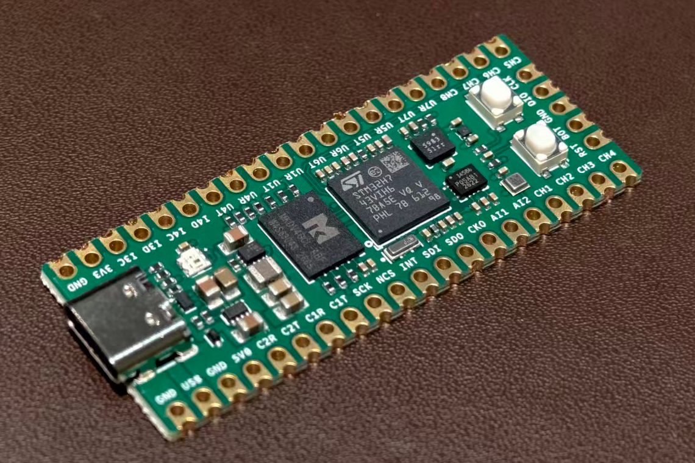
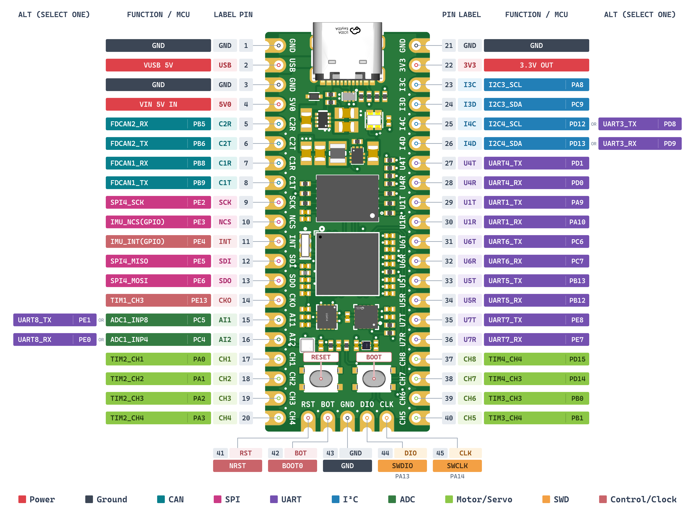

# Everything Can Fly · ECF

开源飞控核心板，以简单外设构建飞控，支持多种固件开发与适配。

ECF 是基于 STM32H743 的开源飞控核心板。本仓库提供 Betaflight、INAV、ArduPilot 和 PX4 的板级源码、构建入口及固件。

**使用范围：仅限科研、教学实验及小型娱乐项目，禁止用于大型货运或载人飞行器**。

- 硬件开源：待补充。
- 项目网页：待补充。

核心板采用 STM32H743VIH6，集成 ICM-45686、BMP581、MMC5983MA 和 SD NAND；尺寸约 51 × 21mm，提供 45 个板边接口位置。VIN 使用稳压 5V，外部信号为 3.3V 逻辑。

简易底板与模拟电源模块为最小接入示例，可替换或自行设计。

<p align="center">
  <a href="assets/ecf-core-photo.jpg">
    
  </a>
</p>

## 硬件规格

以下为器件规格与板级连接。实际主频、量程、采样率和滤波设置由所用固件决定。

- **主控 STM32H743VIH6**：Arm Cortex-M7，最高 480MHz，2MB Flash、约 1MB RAM，支持双精度 FPU 与 DSP 指令；TFBGA100 封装。
- **六轴 IMU ICM-45686**：三轴陀螺仪与三轴加速度计，最大量程分别为 ±4000°/s、±32g；原厂典型噪声密度分别为 3.8mdps/√Hz、70µg/√Hz。板上通过 SPI1 接入，用于角速度与加速度采集。
- **气压计 BMP581**：压力测量范围 300～1250hPa；典型相对精度 ±6Pa（700～1100hPa、15～55°C、10kPa 步进），典型绝对精度 ±30Pa（300～1100hPa、−5～65°C）；最低带宽、最高分辨率设置下压力噪声为 0.08Pa。板上通过 I²C2 接入，用于气压与相对高度估计。
- **磁力计 MMC5983MA**：三轴磁场量程 ±8G（±0.8mT），支持 18-bit 输出，18-bit 模式分辨率为 0.0625mG/LSB；典型总 RMS 噪声 0.4mG（BW=00、25°C、VDD=3.0V）。内置 SET/RESET，板上通过 I²C2 接入，用于磁场与航向估计。
- **日志存储与状态指示**：MKDV4GCL-ABF SD NAND 通过 SDMMC2 四位总线连接，用于日志与运行数据；WS2812B-2020-V6 RGB 灯显示启动及运行状态。
- **主电源 TPS62903**：同步降压芯片，器件输出电流能力为 3A；板上配置为 3.3V、2.5MHz、强制 PWM，供处理器、存储与数字接口使用。
- **传感器电源 TPS7A2030**：300mA 低噪声 LDO，由系统 3.3V 产生传感器 VDD 3.0V；传感器 VDDIO、I²C 上拉仍使用系统 3.3V。

精度、噪声和分辨率为原厂规定条件下的器件参数；整板测量表现受滤波、安装、振动、温度和磁环境影响。3.3V 对外可用电流需扣除板内负载，并按输入能力及散热条件核定。

参数资料：[STM32H743VIH6](https://www.st.com/en/microcontrollers-microprocessors/stm32h743vi.html)、[ICM-45686](https://www.invensense.tdk.com/en-us/products/6-axis/icm-45686)、[BMP581](https://www.bosch-sensortec.com/media/boschsensortec/downloads/datasheets/bst-bmp581-ds004.pdf)、[MMC5983MA](https://www.memsic.com/Public/Uploads/uploadfile/files/20220119/MMC5983MADatasheetRevA.pdf)、[TPS62903](https://www.ti.com/product/TPS62903)、[TPS7A2030](https://www.ti.com/product/TPS7A20)。

输入选择采用 **TPS2117**，在外部稳压 5V VIN 与 USB 5V 之间切换，优先使用 VIN。

## 固件版本

- **Betaflight：2026.6.2 / ECF r4**，源码与说明：[Betaflight](Betaflight/README.md)。
- **INAV：9.1.0 / ECF r5**，源码与说明：[INAV](INAV/README.md)。
- **ArduPilot：ArduCopter 4.7.2 / ECF r4**，源码与说明：[ArduPilot](ArduPilot/README.md)。
- **PX4：v1.17.0 / ECF r3**，源码与说明：[PX4](PX4/README.md)。

ECF 修订号对应板级适配版本。上游提交、依赖版本和镜像校验值见各目录 `release.json`；ArduPilot 当前仅提供 ArduCopter 构建。

## 引脚定义

下图列出 45 个板边位置的编号、丝印及可选功能，出厂用途见“默认配置”。

<p align="center">
  <a href="assets/ecf-pinout.png">
    
  </a>
</p>

## 传感器与驱动适配

- **ICM-45686**：SPI1，陀螺仪与加速度计已在四套固件中适配。
- **BMP581**：I²C2，四套固件均已适配；INAV 包含补充的 BMP581 驱动。
- **MMC5983MA**：I²C2，Betaflight、INAV 包含磁力计驱动适配，ArduPilot、PX4 使用已有驱动完成板级接入。
- **存储与 USB**：已适配 SDMMC2 四位存储、原生日志及 USB 配置／数据连接。
- **输出与状态灯**：已适配 CH1～CH8 的 PWM、普通 DShot 和板载 RGB 状态灯。同一定时器组共用输出时基；INAV 当前无双向 DShot 接收，PX4 双向 DShot 限于 CH1～CH4。
- **外部接口**：已配置 CRSF、GPS、MSP／MAVLink2、串口 ESC 遥测和 DroneCAN，默认用途见下文。外设互通须按实际型号验证。

四套固件已逐一烧录，板载传感器基础调试结果基本正常。现有台架记录包括日志、接口配置及 CH1／3／5／7 的 PWM400、DShot300 波形检查；尚未完成实飞验证。

## 默认配置

以下为上述版本的出厂配置，不含单台设备校准值。单台设备须另行校准。引脚编号按 USB-C 朝上的正面视图。

### 功能复用与电源监测

四套固件均默认使用 **ADC 电压／电流采样＋UART3**：

- **15／AI1、16／AI2**：分别为 ADC 电压、ADC 电流输入（PC5／PC4），共享 UART8 关闭。
- **25／I4C、26／I4D**：分别为 UART3 TX、RX（PD8／PD9），暂不分配外设协议；共享 I²C4 关闭。板上 I4C／I4D 丝印不代表出厂已启用 I²C4。
- **23／I3C、24／I3D**：保留 I²C3，用于外置罗盘。

模式参数为 INAV `ecf_io_mode=1`、ArduCopter `BRD_ALT_CONFIG=1`、PX4 `ECF_IO_MODE=1`；Betaflight 由默认资源映射选择上述组合。

电压、电流默认均为 **ADC 模拟采样**。参考电压分压为 **11∶1**（100kΩ／10kΩ），电流灵敏度为 **20mV/A**（50A/V），电流零偏为 **0**。各固件的比例参数为：

- **Betaflight**：`vbat_scale=110`、`vbat_divider=10`、`vbat_multiplier=1`；`ibata_scale=200`、`ibata_offset=0`。
- **INAV**：`vbat_scale=1100`；`current_meter_scale=200`、`current_meter_offset=0`。
- **ArduCopter**：`BATT_MONITOR=4`；`BATT_VOLT_MULT=11`、`BATT_AMP_PERVLT=50`、`BATT_AMP_OFFSET=0`。
- **PX4**：`BAT1_SOURCE=0`、`SENS_EN_INA238=0`；`BAT1_V_DIV=11`、`BAT1_A_PER_V=50`、`BAT_V_OFFS_CURR=0`。

ADC 输入限于 0～3.3V。更换底板后，按实际分压、灵敏度和零点修改参数，用万用表标定电压，并以零电流和已知负载标定电流。

需要其他组合时，应用各固件 `presets/shared-*` 中的对应预设，保存、重启并读回确认。四种组合为 ADC＋I²C4、ADC＋UART3、UART8＋I²C4、UART8＋UART3；未选 MCU 端保持高阻、无内部上下拉，外部接线须互斥，接口电平为 3.3V。切到 UART8 后，同组 ADC 电源采样停用。

ArduCopter／PX4 可选 I²C4 的 INA238 数字电源监测，须停用同组 UART3；参考配置为 **7 位地址 0x45、0.5mΩ 分流器、120A 换算量程**，须匹配实际模块。Betaflight／INAV 当前没有原生 INA238／INA226 电池监测后端。详细切换步骤见各固件 README 的“功能复用与电源监测”。

### 串口与外设

- **UART1（29／30）**：ELRS 接收机，CRSF 双线、非反相。
- **UART3（25／26）／UART8（15／16）**：UART3 预留、不分配协议；UART8 关闭，见上方复用配置。
- **UART4（27／28）**：Betaflight／INAV 不分配用途；ArduCopter／PX4 用于 GPS2。
- **UART5（33／34）**：Betaflight／INAV 为 MSP，ArduCopter／PX4 为 MAVLink2；默认 115200bit/s。
- **UART6（31／32）**：GPS1。Betaflight／INAV 默认 UBX；INAV 当前不解析 NMEA。ArduCopter／PX4 自动探测受支持的 GPS 协议。
- **UART7（35／36）**：独立串口 ESC 遥测，默认 115200bit/s；与双向 DShot 回传分别配置。INAV 在启用电机输出后启动该遥测驱动。
- **USB**：Betaflight／INAV 使用 MSP；ArduCopter／PX4 使用 MAVLink。

以上按物理 UART 编号说明。PX4 的 GPS2 接物理 UART4（地面站标签 TEL3）；地面站的 GPS2 标签对应 UART7，默认用于 ESC 遥测。

**CAN** 默认使用 DroneCAN、1Mbit/s、节点 ID 10：Betaflight／INAV 启用 CAN1，可切换到 CAN2，一次使用一路；ArduCopter 两路分别使用独立驱动；PX4 两路共用一个节点。CAN 收发器与终端由底板提供。

**I²C3 外置罗盘**：Betaflight／INAV 优先探测外置罗盘，未发现时回退板载 MMC5983MA；ArduCopter／PX4 按原生驱动探测。**SPI4** 默认不启用外部传感器。

**电机输出**：默认 Quad X，CH1～CH4 为 DShot300，CH5～CH8 未分配电机功能。INAV 首次配置仍需在 Outputs 页面启用输出；电机顺序和旋向按各固件混控核对。

## 编译环境

- **Betaflight**：Windows、PowerShell 7、ARM GCC 13.3.1、GNU Make、Git Bash、Python；入口 `build.ps1`。
- **INAV**：Windows、PowerShell 7、ARM GCC 13.3.1、CMake 3.31.10、Ruby 3.3.7、Ninja、Python；入口 `build.ps1`。
- **ArduCopter**：Linux／WSL x86_64、ARM GCC 10.2.1（10-2020-q4-major）、Python 3.12.3、GNU Make、宿主 GCC；入口 `build.sh`。
- **PX4**：Ubuntu 24.04 x86_64／WSL、ARM GCC 13.2.1、Python 3.12、CMake 3.28.3、Ninja 1.11.1、GNU Make、宿主 GCC；入口 `build.sh`，Windows 可使用 `build.ps1` 调用 WSL。

各工程包含完整源码、固定依赖和构建脚本。工具链按指定版本安装，命令见各目录 README。四套源码包均已独立解压重建，HEX／ELF 与对应发布产物逐字节一致。

从 Git 克隆时，按以下步骤保留源码原始换行，以匹配校验清单。直接下载源码包无需此步骤。

```sh
git clone --no-checkout https://github.com/albert17github/ECF.git
cd ECF
python -c "from pathlib import Path; Path('.git/info/attributes').write_text('* -text\n', encoding='utf-8')"
git checkout main
```

## 下载与使用

下载入口：[Releases](https://github.com/albert17github/ECF/releases)。每套固件提供刷写包、完整源码包和 SHA-256 校验清单。刷写包包含最终镜像和安装说明；首次安装、升级与参数恢复步骤见对应固件 README。

调试 ELF 随完整源码包提供，位于包内 `firmware/debug/`。

## 许可

Betaflight、INAV、ArduPilot 保留各自 GPLv3 许可，PX4 保留 BSD 3-Clause 许可；第三方代码遵循其随附声明。具体许可范围以各目录的 LICENSE 和源文件声明为准。
